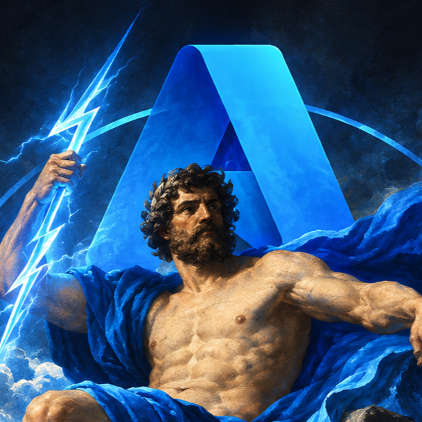

<div align="center">

  

  # AZeus v2

  ### Azure Post-Authentication Security & Reconnaissance Toolkit

  <p align="center">
    <b>Empowering cloud red teams, penetration testers, and purple teamers with deep asset enumeration and contextual cloud reconnaissance.</b>
  </p>

  <!-- Badges / Stickers -->
  <p align="center">
    
    
    
  </p>

</div>

---

### Project Status: Active Development (Alpha v2)
**AZeus v2 is currently in active prototyping and development.** It is **not yet fully functional or production-ready**. Core components, data extractors, and UI interfaces are undergoing frequent refactoring. Expect breaking changes, experimental modules, and incomplete workflows.

---

## // The Vision for AZeus v2

AZeus v2 is being designed from the ground up to solve one of the biggest challenges in cloud security assessments: **making sense of post-authentication access in complex Azure environments**.

Rather than dumping unformatted CLI JSON or relying on disconnected scripts, AZeus v2 unifies identity context, resource inventories, and sensitive cloud secrets into a cohesive, interactive workspace.

### [+] Future Milestone: AI-Driven Security Intelligence
The ultimate milestone for AZeus v2 is the integration of an **AI Reasoning Layer**:
- **Smart Cloud Insights**: Utilizing intelligent models to analyze enumerated cloud configurations and surface high-risk vulnerabilities.
- **Automated Attack Path Mapping**: Correlating discovered identities, Key Vault permissions, and cloud resources to highlight privilege escalation vectors.
- **Plain-English Security Briefings**: Translating complex cloud entitlements into actionable executive summaries and offensive debriefs.

---

## // Tech Stack

AZeus v2 is built for speed, responsiveness, and zero-overhead local deployment:

- **Core Runtime & Logic**: Python 3.10+ (pure Python backend)
- **Web & ASGI Framework**: [Quart](https://quart.palletsprojects.com/) -- high-performance asynchronous web framework (async/await native)
- **Official Azure Cloud SDK**:
  - `azure-identity` (`AzureCliCredential` utilizing active `az login` tokens)
  - `azure-mgmt-subscription` (Subscription enumeration & metadata)
  - `azure-mgmt-resource` (Resource Group tracking & asset discovery)
  - `azure-mgmt-keyvault` (Control-plane Key Vault exploration)
  - `azure-keyvault-secrets`, `azure-keyvault-keys`, `azure-keyvault-certificates` (Data-plane secret/key/cert retrieval)
  - `msgraph-sdk` (Microsoft Graph directory reconnaissance -- integration underway)
- **Frontend Architecture**: Custom modern dark-mode / glassmorphic UI built exclusively with semantic HTML5, Vanilla JavaScript, and native CSS3 design tokens (zero heavy node-modules or frontend build pipelines).

---

## // Getting Started: How to Run

Follow these steps to launch the AZeus v2 console locally:

### 1. Prerequisites
- Python 3.10 or higher
- [Azure CLI](https://learn.microsoft.com/en-us/cli/azure/install-azure-cli) installed on your system

### 2. Azure Authentication
Authenticate your terminal session with Azure CLI:
```bash
az login
```
If you have access to multiple subscriptions, ensure your desired target subscription is active:
```bash
az account set --subscription "<SUBSCRIPTION_NAME_OR_ID>"
```

### 3. Install Dependencies
Set up a Python virtual environment and install the required packages:
```bash
python -m venv .venv

# Windows (PowerShell)
.venv\Scripts\Activate.ps1

# Linux / macOS
source .venv/bin/activate

pip install -r requirements.txt
```

### 4. Launch the Console
Start the local Quart application:
```bash
python main.py
```

### 5. Access the Web Interface
Open your web browser and navigate to:
```
http://localhost:8089/home
```

---

## // Current Implementations & Features

AZeus v2 currently features an interactive multi-view security console:

### 1. Identity & Tenant Context
- Direct authentication hook via local Azure CLI session (`AzureCliCredential`).
- Automated enumeration of:
  - **Entra ID Tenant Context**: Tenant ID, Tenant Name, Primary Domain, Directory SKU.
  - **Active Azure Subscription**: Subscription ID, Display Name, State.
  - **Authenticated Operator**: Local signed-in user identity.

### 2. Key Vault Enumeration & Secret Discovery
- Subscription-wide discovery of deployed Key Vaults.
- Automatic permission evaluation: classifies vaults as **Accessible** vs **Restricted** based on real data-plane retrieval validation.
- Enumerates Secret Identifiers with content types and modification timestamps.
- Live secret value extraction with click-to-reveal inspection and copy utilities.
- Cryptographic keys discovery (key types, permitted operations, statuses).
- Digital certificates inventory (SHA-1 thumbprints, expiration tracking).

### 3. Resource Groups & Cloud Asset Inventory
- Comprehensive discovery of all Resource Groups in the subscription.
- Top switcher dropdown for seamless switching between target Resource Groups.
- Live asset tables with categorized filters:
  - **All Discovered Resources**
  - **Key Vaults**
  - **Compute & Virtual Machines**
  - **Storage Accounts & Databases**
  - **Networking Infrastructure**
- Resource Group summary table showing location, provisioning state, and asset count.
- One-click JSON data dumps for offline assessment and evidence preservation.

---

## // Known Bugs & Limitations

As an alpha-stage post-authentication toolkit, AZeus v2 currently has the following limitations:

- **Non-Exhaustive Enumeration**: Certain cloud resource types and advanced Azure services are not yet mapped.
- **Granular RBAC Handling**: If an operator holds Azure Control Plane permissions (e.g. Contributor/Reader) but lacks Data Plane roles (e.g. Key Vault Secrets Officer), value extraction will be restricted. Detailed permission diagnostic trees are still being refined.
- **Pagination on Enterprise Environments**: Subscriptions containing thousands of resources or vaults may experience API throttling or partial results due to lack of chunked streaming cursor pagination.
- **Single-Context Restriction**: Currently operates against the default active subscription configured in the local Azure CLI context; cross-subscription multi-tenancy traversal is not yet wired up.
- **Demo Placeholders**: Certain overview summary metrics still utilize transitional fallback data when backend queries encounter rate limits or empty results.

---

## // Roadmap: Future Versions & Modules

| Category | Planned Feature | Status |
| :--- | :--- | :---: |
| **[AI Core]** | AI-driven attack path analysis & misconfiguration correlation | [Planned] |
| **[AI Core]** | Automated executive & technical debrief report generation | [Planned] |
| **[Entra ID]** | Deep Directory Enumeration: Users, Groups, App Registrations, Service Principals | [In Progress] |
| **[Entra ID]** | Conditional Access Policy and Privileged Access audit | [Planned] |
| **[RBAC]** | Role assignments & custom role definition privilege escalation mapping | [Planned] |
| **[Storage]** | Blob container enumeration, public anonymous access checks & SAS token scanner | [Planned] |
| **[Compute]** | VM metadata extraction, NSG inbound exposure analysis, and Managed Identity audit | [Planned] |
| **[Multi-Tenant]** | Interactive subscription and tenant switcher within the UI | [Planned] |
